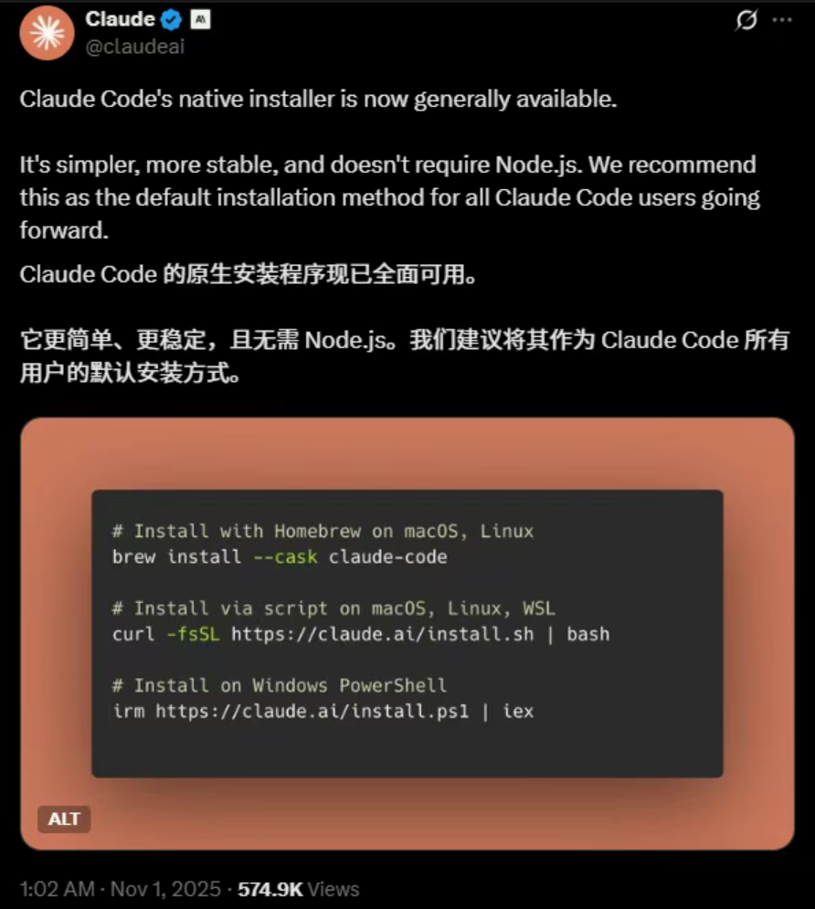
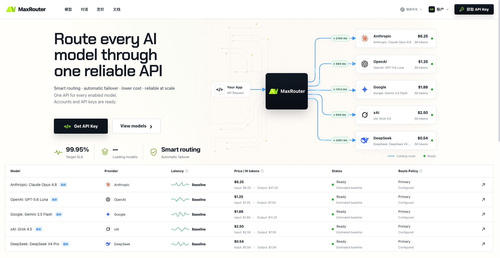
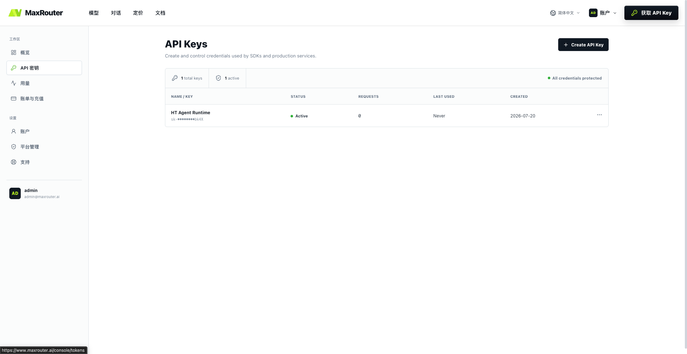
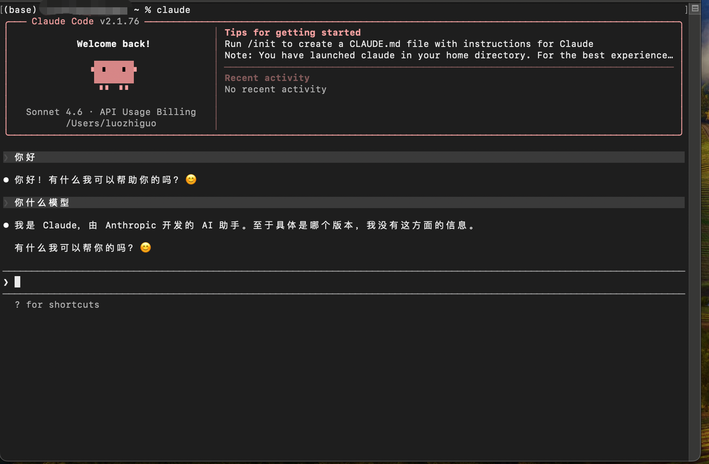
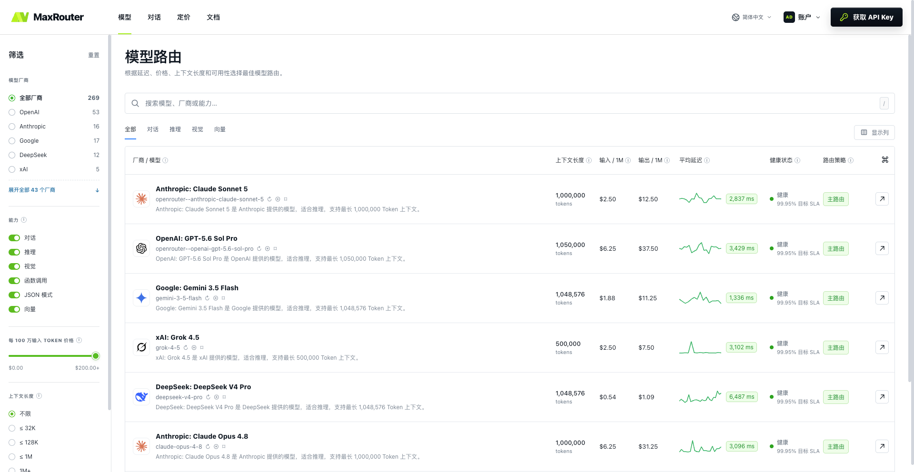
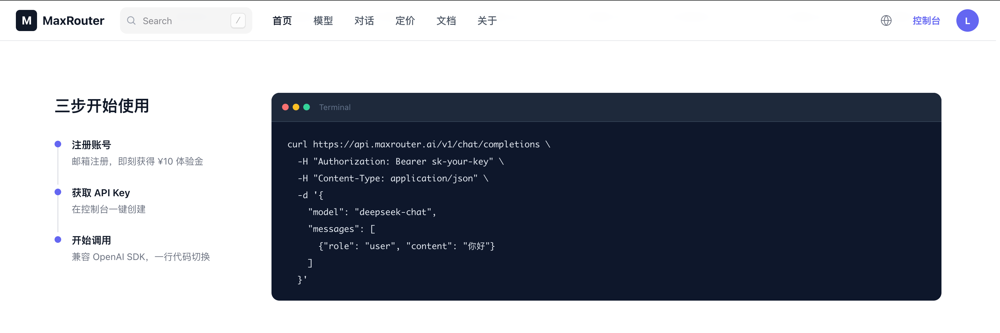

# Claude Code 国内使用教程 | 安装配置到实战完整指南【2026】

> **Claude Code 国内怎么用？** 这是一篇面向国内开发者的 Claude Code 完整使用教程，涵盖安装、配置、国内网络问题解决方案、API 中转配置、日常使用技巧等。无论你是第一次接触 Claude Code，还是已经在用但被网络问题困扰，这篇指南都能帮到你。

> 维护说明：本文由 MaxRouter 运营方维护，不是独立第三方推荐。修订日期：2026-11-03。历史截图仅供界面参考，不代表当前价格、赠额或兼容性验收。

相关教程：[Pi Coding Agent 独立教程：安装、Opus 5.5 接入与实测](https://github.com/MaxRouterAI/pi-coding-agent-guide)。

## 先完成第一次调用

- 已有 API Key：[先查模型，再发一条消息并核对用量](./docs/first-call.md)。提供无依赖 Node.js 示例，默认只查模型，明确执行 `--send` 才生成一次。
- 准备连接 Claude Code：[打开接入文档](https://www.maxrouter.ai/docs?utm_source=github&utm_medium=readme&utm_campaign=first_call_202611&utm_content=claude_code_guide)，按下面的配置清单核对。先在当前终端验证，不覆盖已有全局配置。

新增首调教程与示例维护日期：2026-11-04。示例的验证范围见教程末尾；离线测试不代表真实模型或全部工具功能已验收。

---

## 什么是 Claude Code

Claude Code 是 Anthropic 推出的命令行 AI 编程工具。跟 Copilot 这类 IDE 插件不同，它不是补全几行代码那么简单 — 它是一个真正的 AI Agent，可以：

- 阅读和理解你的整个项目
- 自主编写、修改、删除文件
- 执行终端命令（编译、测试、部署）
- 管理 Git（提交、分支、合并）
- 跨文件重构、分析 bug、生成文档

你只需要用自然语言描述需求，它会自己规划步骤然后执行。



## 安装 Claude Code

### 系统要求

- 操作系统与安装方式请按 [官方快速开始](https://code.claude.com/docs/en/quickstart) 核对，不沿用旧版本最低系统要求。
- 推荐使用原生安装器（无需手动安装 Node.js）

### 安装命令

以下为官方原生安装方式。运行安装脚本前请核对来源与内容；本文没有代你执行安装：

**macOS / Linux：**

```bash
# 推荐：原生安装器
curl -fsSL https://claude.ai/install.sh | bash

# 或者通过 Homebrew
brew install --cask claude-code
```

**Windows PowerShell：**

```powershell
irm https://claude.ai/install.ps1 | iex
```

安装完成后验证：

```bash
claude --version
```

> 安装受阻时先记录系统、命令和错误，查阅官方安装排错说明；不要为安装盲目更换全局镜像或绕过组织网络权限。

## 官方使用方式

账户登录、API 认证与订阅权益不是同一计费方式，使用前查阅 [官方快速开始](https://code.claude.com/docs/en/quickstart) 和账户当前条款。本文不沿用旧订阅价格与用量数字。

## 国内使用的现实问题

不同地区、账户与支付方式的可用性有差异，请查询服务当前支持范围和条款。本文不保证特定账户一定可注册、接入或退款，也不以个别网络错误推断所有用户的情况。

## 使用第三方 API 服务前，先确认接入范围

[MaxRouter](https://www.maxrouter.ai?utm_source=github&utm_medium=article&utm_campaign=existing_articles&utm_content=claude_code_guide) 提供大模型 API 接入服务；可用模型、接口协议、账户权限和价格，以 [当前产品文档](https://www.maxrouter.ai/docs?utm_source=github&utm_medium=article&utm_campaign=existing_articles&utm_content=claude_code_guide) 与账户展示为准。

Claude Code 支持配置网关，不等于任意网关都兼容全部功能。接入前核对目标地址、认证方式、模型 ID，以及流式响应、工具调用和错误处理支持范围。本文不作“官方同价”“全系列模型”或全部请求直达官方的承诺。



## 配置步骤

按下面清单逐项核对；启动界面不等于任务验收通过。

### 1. 注册并获取 API Key

访问 [www.maxrouter.ai](https://www.maxrouter.ai?utm_source=github&utm_medium=article&utm_campaign=existing_articles&utm_content=claude_code_guide) 注册账号。试用资格、币种、金额和有效期，以注册时活动说明和账户实际展示为准，不沿用旧版具体赠额。

按账户界面管理自己的凭据；不要把 Key 放进公开仓库、截图或评论。下面是历史界面示意：



### 2. 核对地址与认证来源

先记录 `claude --version`，再按 [官方网关说明](https://code.claude.com/docs/en/llm-gateway-connect) 与 [MaxRouter 文档](https://www.maxrouter.ai/docs?utm_source=github&utm_medium=article&utm_campaign=existing_articles&utm_content=claude_code_guide) 核对：

| 核对项 | 判定方式 |
|---|---|
| 目标地址 | 使用服务明确给出的 Claude Code 地址；不要自行增删路径 |
| 认证变量 | `ANTHROPIC_AUTH_TOKEN` 对应 Bearer，`ANTHROPIC_API_KEY` 对应 x-api-key，按服务要求选择 |
| 生效来源 | 在会话内用 `/status` 私下检查；设置文件中的 env 与 shell 变量可能冲突 |
| 模型与功能 | 核对模型 ID、流式结束和工具调用，不以聊天成功代替全部功能验收 |

真实密钥只填写到可信本地配置；不要混用官方和第三方凭据，也不要为了排错直接删除旧配置。本文未附当前 MaxRouter 端到端验收记录，因此不提供未经验证的一键接通保证。

### 3. 启动

```bash
claude
```

界面打开只说明程序已启动。还需用明确的小任务核验结果，并记录版本、模型 ID、错误和重试。以下旧截图不作为当前接入成功证据：



## 模型选择

使用 `/model` 查看当前工具可选项，并与服务账户权限核对。不要由显示名称自行拼接模型 ID。先用同一小任务比较结果、耗时与消耗，再选择日常型号。

模型与价格以 [MaxRouter 当前页面](https://www.maxrouter.ai/pricing?utm_source=github&utm_medium=article&utm_campaign=existing_articles&utm_content=claude_code_guide) 为准；以下为历史截图：



## 日常使用

### 常用命令

| 命令 | 说明 |
|------|------|
| `/help` | 查看帮助 |
| `/model` | 切换模型 |
| `/compact` | 压缩上下文，省 token |
| `/clear` | 清除对话 |
| `/cost` | 查看当前消耗 |
| `Ctrl+C` | 中断操作 |
| `/exit` | 退出 |

实际命令以本机 `/help` 为准；`/cost` 与服务账户可能采用不同统计口径。

### 实际场景

以下任务可能修改文件、安装依赖或提交代码。先备份，在可审查分支执行，并逐项审阅差异与测试结果。

**让它帮你写一个完整功能：**

```
> 帮我创建一个 Express + TypeScript 项目，包含用户注册登录（JWT）、SQLite 数据库、输入验证（zod）、错误处理中间件和单元测试
```

它会自己初始化项目、装依赖、写代码、跑测试，你只需要审查确认。

**修 bug：**

```
> 用户反馈传入空数组时这个函数会崩溃，帮我修复并加上测试
```

**重构：**

```
> 把这个项目从 JavaScript 迁移到 TypeScript，保持功能不变
```

**跨文件操作：**

```
> 给所有 API 接口加上请求日志中间件
```

**代码审查：**

```
> 审查 src/services/ 下的所有文件，找出安全隐患和性能问题
```

**Git 操作：**

```
> 帮我提交当前修改，commit message 写清楚
> 创建 feature/add-auth 分支
```

## 进阶技巧

### CLAUDE.md 文件

在项目根目录放一个 `CLAUDE.md`，Claude Code 启动时会自动读取。相当于给它一份项目说明书：

```markdown
# CLAUDE.md

## 项目简介
电商后台管理系统，React + TypeScript + Ant Design

## 编码规范
- 函数组件 + Hooks，不用 Class
- 状态管理用 Zustand
- API 请求放 src/api/
- 组件文件名 PascalCase

## 常用命令
- npm run dev — 开发服务器
- npm run test — 跑测试
- npm run build — 生产构建
```

### /compact 省钱

聊久了上下文会很长，token 消耗快。用 `/compact` 压缩历史，保留关键信息。

### 配合其他工具

Cursor、Cline 和 Continue 各有配置方式，需分别核对工具版本、协议、模型和功能。聊天成功不能代替编辑、工具调用、图片与长上下文验收，不把旧 JSON 配置当作全部工具的通用现行配置。



## 常见问题

**Q：报错 403、401 或超时？**
记录版本、认证类型、错误类别和时间，分别排查凭据、权限、地址和网络。改地址不保证消除这些错误，不公开 Key 或完整配置。

**Q：流式输出和官方一样吗？**
按具体模型、协议与工具验证。收到部分文字不等于正常结束，还要检查结束信号和错误处理。

**Q：数据安全如何判断？**
使用前核对当前隐私政策、日志保留范围和上游处理路径。本文不承诺“完全不存储”或“全部请求直达官方”。

**Q：怎么核对用量？**
先确认计费身份与统计窗口，再查看 [MaxRouter 控制台](https://www.maxrouter.ai/console/overview?utm_source=github&utm_medium=article&utm_campaign=existing_articles&utm_content=claude_code_guide)。工具统计不能直接当作相同口径的账单。

**Q：下一步做什么？**
先打开 [MaxRouter 文档](https://www.maxrouter.ai/docs?utm_source=github&utm_medium=article&utm_campaign=existing_articles&utm_content=claude_code_guide) 核对目标工具的接入说明；确认权限和可能费用后，在自己的测试项目完成一个“输入、预期输出、验收方式”明确的小任务。

## 相关链接

- [Claude Code 官方文档](https://docs.anthropic.com/en/docs/claude-code)
- [Anthropic 官网](https://www.anthropic.com/claude-code)
- [MaxRouter](https://www.maxrouter.ai?utm_source=github&utm_medium=article&utm_campaign=existing_articles&utm_content=claude_code_guide) — 本文维护方的 API 平台
- [MaxRouter 文档](https://www.maxrouter.ai/docs?utm_source=github&utm_medium=article&utm_campaign=existing_articles&utm_content=claude_code_guide)
- [MaxRouter 模型与价格](https://www.maxrouter.ai/pricing?utm_source=github&utm_medium=article&utm_campaign=existing_articles&utm_content=claude_code_guide)

---

如果这篇教程帮到了你，给个 ⭐ Star 让更多人看到。有问题欢迎提 Issue。
