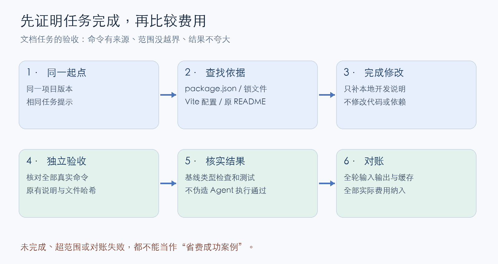
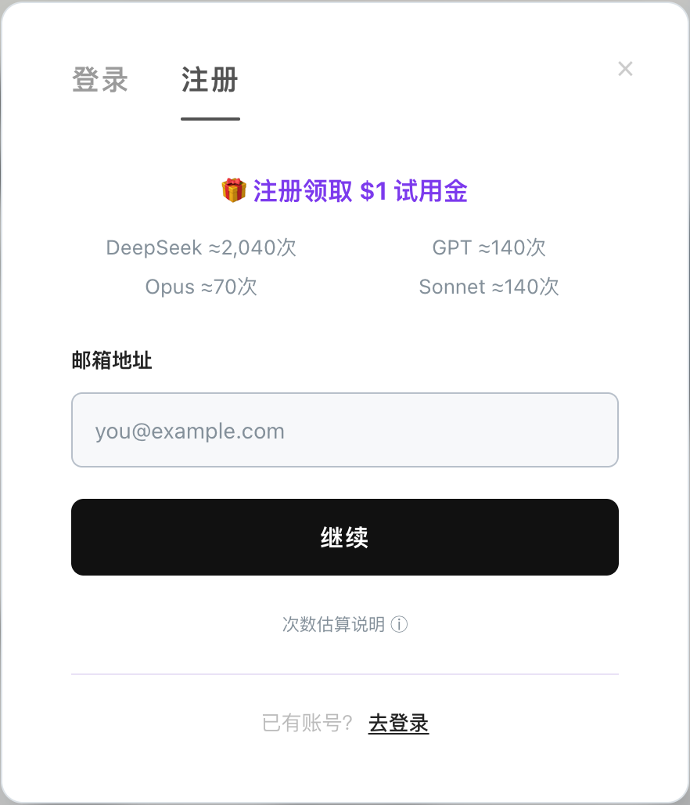
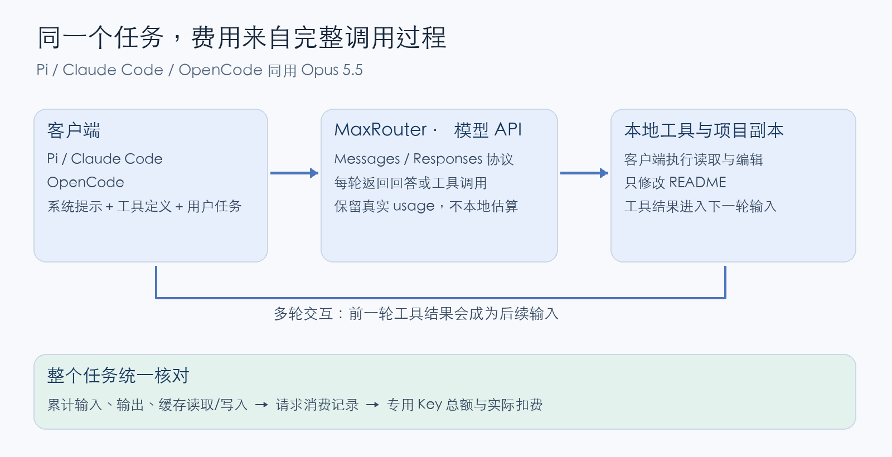
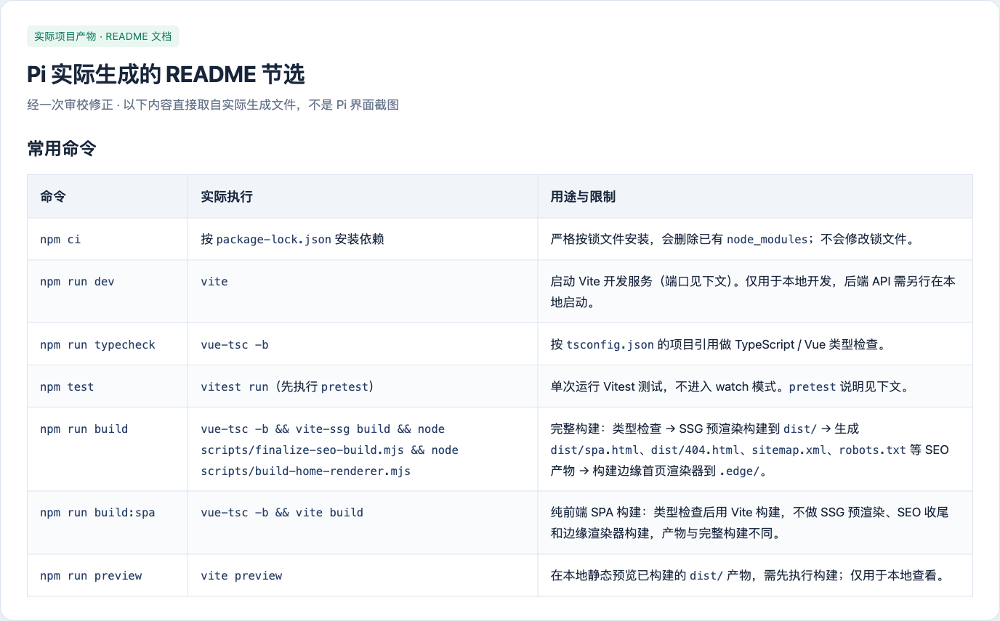
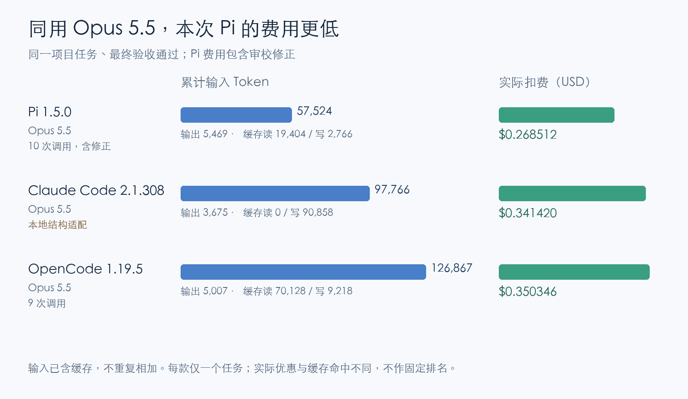

# AI 编程越聊越贵？用 Pi 把 Token 花在代码上

作者：MaxRouter 团队 · 实测日期：2026-11-05

同一个前端项目、同样补齐 README 的任务，三款工具都用 **Opus 5.5**，最终都通过独立审校。Pi 含修正的实际费用为 **$0.268512**：本次比 Claude Code 少 **21.4%**，比 OpenCode 少 **23.4%**；累计输入 Token 分别少 **41.2%** 和 **54.7%**。

这篇文章沿着这次任务，讲清楚怎么把 Pi 接到模型、限定读取范围、核对交付质量，再看完整账单。数字来自本次实际调用；缓存和优惠条件也会影响费用。

## 先看一次相同问候的实际开销

两款工具都通过 MaxRouter 使用 Claude Sonnet 4.6，按 API 用量计费，在全新空目录会话里收到同一句话：

> 只回复“你好”两个汉字，不要使用任何工具。

两次最终回答都是“你好”。2026 年 11 月 5 日的实际记录如下：

| 工具 | 输入总 token | 缓存读 / 写 | 输出 token | 实际扣费（USD） |
| --- | ---: | ---: | ---: | ---: |
| Pi 1.5.0 | 1,958 | 0 / 1,948 | 30 | $0.007786 |
| Claude Code 2.1.308 | 17,765 | 0 / 17,755 | 15 | $0.066836 |

输入总量已经包含缓存读写，不能重复相加。本轮没有缓存读取命中；写入缓存仍有费用。金额来自实际账单，并已与专用密钥总额核对。本轮两笔按标准价扣费，未触发五折优惠。

为什么只说一句话，也会有这么多输入？因为客户端还会发送自己的系统提示和工具定义。即使本次没有使用工具，这些说明也可能随请求一起发送。

这轮使用独立配置、不加载个人扩展，保留各自内置提示和工具。两端思考设置也不完全相同，因此这里只观察各自配置下的一次问候开销。**每款仅测一次，它不代表完成真实编程任务的平均成本或固定节省率。**[问候测试条件与记录](./greeting-comparison-method.md)

## 一、把任务跑完：补齐一个真实前端项目的开发说明

接下来项目任务的对比统一使用 **Opus 5.5**。开头的问候使用 Sonnet 4.6，两组结果分开看。

我取了自有 Vue 3 / TypeScript 前端项目的一份固定版本快照。原 README 只有四条验证命令，缺少环境要求、启动方式、开发代理、测试前置步骤，以及两种构建方式的区别。

任务明确为：**只修改 README，根据已有配置补齐中文本地开发说明。**模型需要读取真实文件、找到命令依据、编辑文件并交付；这不是让模型凭空写一段回答。

Pi、Claude Code、OpenCode 从独立副本开始，收到相同的任务要求。没有加入个人扩展或自定义项目规则，保留各自内置的系统提示和工具。完成标准也相同：

- 安装、启动、类型检查、测试、完整构建、SPA 构建和预览，共七类命令都有依据。
- 环境要求来自实际配置或锁文件，分清“项目明确声明”和“依赖间接要求”。
- 解释开发端口、API 代理和 `pretest`，不把本地构建说成生产发布。
- 保留原说明，只改 README，不修改源码或依赖，不虚构测试通过。

测试前，项目快照的类型检查通过，**65 个测试文件、441 项测试通过**。这是测试者建立的项目基线；三款 Agent 按任务要求处理文档，未执行 npm 命令。



*图：先检查产物和边界，再核对整个任务账单。读取、编写、修正和最终回答的调用都要计入。*

**你不用下载这个前端项目。**下面的操作使用你自己的已有 Node.js 项目，命令从自己的配置中找。MaxRouter 只负责提供在线模型 API。

## 二、安装 Pi，用 Opus 5.5 接上自己的项目

这次执行开发任务的工具是 **Pi Coding Agent**。它运行在终端里，可以读取文件、执行命令、修改代码，也能加载项目根目录的 `AGENTS.md` 作为工作说明。

选择 Pi，是因为这些工作入口比较清楚：你可以看到它读了哪些文件、执行了哪些命令，也能通过项目说明约定读取范围和验证方式。本文用它管理这次开发的上下文。

下面命令使用 Bash。macOS 默认使用 Zsh 时，可以先输入 `bash`。需要 Node.js 22.19 或更高版本；低于这个版本时先升级 Node.js，再安装 Pi。

```bash
node --version
npm install -g --ignore-scripts @earendil-works/pi-coding-agent@1.5.0
pi --version
```

这里固定本次实测使用的版本，方便复现。Pi 本身是开发工具，实际回答和代码生成需要连接模型服务。[Pi 官方安装说明](https://pi.dev/docs/latest/quickstart)

### 登录 MaxRouter，创建这次练习的 Key

本文使用 **MaxRouter 接入 Claude Opus 5.5**。目前平台部分 Claude 型号提供五折优惠，适用时约为官方标准 API 价格的一半；具体型号和价格以模型页面展示及实际账单为准。[MaxRouter 模型页面](https://www.maxrouter.ai/models/anthropic-claude-opus-5.5?utm_source=github&utm_medium=article&utm_campaign=pi_opus55_202611&utm_content=pi_opus55_model)

先打开 [MaxRouter](https://www.maxrouter.ai/?utm_source=github&utm_medium=article&utm_campaign=pi_opus55_202611&utm_content=pi_context_guide)，点击页面上的登录按钮。已有账号直接登录；没有账号，可以使用邮箱注册并完成验证码验证。

**目前邮箱验证注册可领取 $1 共享试用余额，可以用于体验 Opus 5.5，按实际 Token 用量扣减。**这是一笔体验金，不是不限次数；页面上的次数是特定输入输出长度下的参考估算。



*图：2026 年 11 月 5 日真实页面截图，未填写账号资料。*

登录后按这个顺序操作：

1. 进入控制台，打开 **API 密钥 / API Keys**。
2. 点击 **创建 API 密钥 / Create API Key**。
3. 名称填写 `pi-practice`，便于以后识别这次练习的调用。
4. 创建后复制完整 Key，保存在自己的密码管理器中。

接着在准备运行 Pi 的终端里输入：

```bash
read -rsp '粘贴 MaxRouter API Key：' MAXROUTER_API_KEY
echo
export MAXROUTER_API_KEY
```

输入不会回显，密钥也不会作为命令文本写进历史记录。不要把它贴进给 Pi 的任务描述，配置文件里也只引用环境变量。

### 把 MaxRouter 加入 Pi 配置

创建 Pi 的配置目录：

```bash
mkdir -p "$HOME/.pi/agent"
```

编辑该目录下的 `models.json`，加入下面的配置。如果文件已经有其他 `providers`，保留原有内容，只添加 `maxrouter` 这一项。

```json
{
  "providers": {
    "maxrouter": {
      "baseUrl": "https://api.maxrouter.ai",
      "api": "anthropic-messages",
      "apiKey": "$MAXROUTER_API_KEY",
      "models": [
        {
          "id": "anthropic-claude-opus-5.5",
          "name": "Claude Opus 5.5",
          "reasoning": true,
          "input": [
            "text"
          ],
          "contextWindow": 1000000,
          "maxTokens": 8192
        }
      ]
    }
  }
}
```

这里有三项需要对应清楚：`baseUrl` 是模型 API 地址，`apiKey` 读取刚才设置的环境变量，`id` 是平台公开的完整模型 ID。这里使用 Claude 的 Messages 协议，`baseUrl` 填域名即可，SDK 会添加请求路径。[Pi 自定义模型配置](https://pi.dev/docs/latest/models-configuration)

`maxTokens` 是单次输出上限，不表示每次都会消耗这么多。也不要为了省钱把它压得过低，导致代码生成到一半就结束。

配置保存后，先启动 Pi，确认模型能正常连接：

```bash
pi --provider maxrouter --model anthropic-claude-opus-5.5 --thinking medium
```

第一次可以先输入一句：

```text
请只回复“Pi 已连接”，不要调用工具或读写文件。
```

这会发起一次真实模型调用。收到回答后输入 `/quit`，接下来进入自己的项目，再重新启动 Pi。以后重新打开终端，也需要先设置 `MAXROUTER_API_KEY`。

## 三、给任务划范围，让 Pi 根据文件作答

在终端切换到自己的项目目录。macOS 可以输入 `cd `，把项目文件夹拖到终端，再回车。用 `pwd` 确认目录后启动：

```bash
pi --provider maxrouter --model anthropic-claude-opus-5.5 --thinking medium
```

下面是本次实测任务的核心要求，读者可以照着调整：

```text
只修改 README.md，补齐中文“本地开发”说明。

先确认 package.json 是否存在；不存在就停止，不创建新项目。
查看 package.json、锁文件文件名、vite.config.ts 和已有 README，
缺少依据时再补查相关本地配置。

说明运行环境的有据要求；没有 engines 或 packageManager 就明确未声明。
包管理器与锁文件一致，不编造项目没有的脚本。

列出安装、启动、类型检查、测试、完整构建、纯前端构建、预览的真实命令，
说明用途与限制、开发端口、本地 API 代理和 npm test 的 pretest。

保留原 README，只增加这次需要的说明。
不修改源码、依赖或部署配置，不读取密钥或工作目录外的文件。
不联网、不安装依赖、不启动服务、不运行 npm 命令。
没有实际执行的检查，不要写成“已经测试通过”。
完成后简述修改内容和命令依据。
```

如果项目不是 Vite 项目，就换成项目实际使用的构建配置；不要让模型创建一个不存在的 `vite.config.ts`。

这段要求不是靠一句“节省 Token”控制费用，而是让工具知道修改范围、信息入口和完成标准。为补几条开发说明，通常不需要先遍历整个业务代码。



*图：每次读取的内容都可能进入后续请求。先找到相关文件，再按需补查，比把整个目录一次塞进对话更容易控制范围。*

本次 Pi 实际读取了项目配置与相关构建脚本，随后补齐了开发说明。以下是它真实产物中的命令部分节选：



*图：实际 README 产物节选的浏览器渲染截图，经过一次审校修正；不是拼造的 Pi 软件界面。*

## 四、生成文件不等于做对了：这次确实查出了问题

不能只看客户端退出成功，也不能只看文件变长了。

本次独立审校发现 Pi 首次产物有两处问题：一处误写“代理只在 dev 生效”；另一处环境建议遗漏了锁文件里 Wrangler 对 Node 的要求。

第一处可以直接对照 Vite 文档：`preview.proxy` 默认继承 `server.proxy`，项目没有覆盖时，预览服务也会继承代理。第二处需要把相关开发依赖的版本要求一起核对，不能只看 Vite。

我把这两条验收意见交回原生 Pi，让它实际修正，没有替它手工改产物。修正后重新核对命令来源、环境建议、代理行为和文件范围，未发现新的实质错误。

Pi 首次编写用了 **5 次调用、$0.151434**；修正另开了一个新会话，又用了 **5 次调用、$0.117078**。交付成本因此是 **10 次调用、$0.268512**，而不是只报第一版的费用。

这也是为什么费用要算到验收完成，而不是算到第一次生成。下面的 Pi 总费用包含必要修正，不能拿未审校的第一版费用当成交付成本。

本次是**项目文档任务**，验收针对命令和说明的准确性、来源与修改范围，不把它扩大成复杂编码能力或长期正确率的结论。

## 五、完整任务到底花了多少？

**同模型主对比：三款都使用 Opus 5.5。最终文档均通过本次独立审校。**

| 工具 | 调用 | 输入总 Token | 输出 Token | 缓存读 / 写 | 实际 USD |
| --- | ---: | ---: | ---: | ---: | ---: |
| Pi 1.5.0（含修正） | 10 | 57,524 | 5,469 | 19,404 / 2,766 | $0.268512 |
| Claude Code 2.1.308¹ | 5 | 97,766 | 3,675 | 0 / 90,858 | $0.341420 |
| OpenCode 1.19.5 | 9 | 126,867 | 5,007 | 70,128 / 9,218 | $0.350346 |

本次完成并验收后的 Pi 费用，比 Claude Code 低 **21.4%**，比 OpenCode 低 **23.4%**。这里已经包含 Pi 的修正费用。

输入总量也更少：Pi 为 **57,524 Token**，Claude Code 为 **97,766**，OpenCode 为 **126,867**。这说明在这次任务中，Pi 累计送入模型的输入较少；不能进一步推断所有编程任务都有相同比例的节省。



*图：三款均使用 Opus 5.5，数据来自完整任务的逐笔调用和实际账单。Pi 包含审校修正；缓存和优惠条件不同，结论限定于本次样本。*

输入总量包含普通输入、缓存读取和缓存写入，表内缓存列是其中的细分项，**不要再加一次**。输出使用接口与账单记录的输出量，没有按最终可见字数自行估算。

¹ Claude Code 的这次成功结果经过本地结构兼容适配：将消息列表里的系统消息移到 Messages 协议的顶层系统字段，保留原文；没有修改线上服务。它不是未经适配的原生直连结果。

**表中金额都是实际扣费，不是估算，也没有统一乘五折。**本轮既有享受优惠的请求，也有标准价请求；缓存命中也不同。因此最终价差同时受用量、缓存与实际优惠影响，不能全部归因于客户端本身。

表内保留完整任务费用，包括 Pi 的审校修正。其他模型的补充测试、接入排查及未完成尝试单独记录在[实验附录](./project-comparison-appendix.md)，可核对全部实测支出。

这些是全新客户端会话，但不保证服务端都是冷缓存；缓存按真实命中记录。每款只有这一个项目任务样本，也没有对 Pi 做“优化前后”的重复 A/B 实验，所以不写固定节省率。

完整条件、逐次数据与限制见[项目任务实测记录](./project-comparison-method.md)。主文仅比较同用 Opus 5.5 的三款配置；Codex 的不同模型结果见附录。

## 六、把有用的上下文规则留在项目里

这次任务用几项明确约束控制工作范围：先读配置、只改 README、需要时补读相关脚本、没有执行就不声称通过。

如果它们适合你的项目，可以放进根目录 `AGENTS.md`。已有文件时追加，不覆盖原有说明：

```markdown
# 项目工作约定

- 先确认任务范围，定位入口后再读取必要文件。
- 启动和验证命令以实际配置为准，不凭经验编造。
- 环境要求区分项目声明与依赖要求，必要时查锁文件。
- 保留现有测试，未经执行的检查如实说明。
- 较长日志保留到文件，成功时返回摘要、退出状态与日志路径。
- 失败时保留关键错误，必要时继续读取原始日志。
- 不读取或打印密钥、令牌等敏感信息。
```

对于真正需要运行测试的代码任务，可以要求 Pi 把完整日志保存到 `.artifacts`，成功时先返回摘要，失败时展示关键错误并保留原始文件。这是在管理日志进入后续对话的方式，不能靠少执行测试来制造省钱效果。

MaxRouter 控制台的 **用量记录 / Usage** 可以按时间和模型核对请求，记录中的 Key ID 用于区分密钥。缓存详情查看 API 返回的 `usage`；缺字段记为未知，不能直接当零。自定义模型在 Pi 里没有单价元数据时，客户端显示的费用可能不完整，实际以平台账单为准。

你可以先用注册赠送的体验余额接上 Opus 5.5，再挑一个边界清楚的小任务，核对修改、验收和完整账单。真正值得保留的做法，是在任务完成、说明正确的前提下，减少无关读取和反复修正。

### 参考

- [Pi 官方安装与配置文档](https://pi.dev/docs/latest/quickstart)
- [Vite：预览服务选项](https://vite.dev/config/preview-options#preview-proxy)
