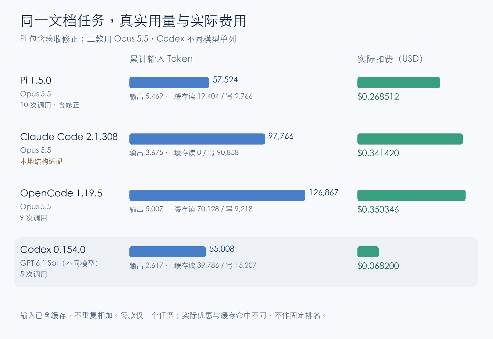

# 实验附录：不同模型结果与全部支出

主文讨论“同用 Opus 5.5 完成相同文档任务时，Pi 的本次实测费用更低”。这里记录 Codex 搭配 GPT 6.1 Sol 的补充结果。模型、单价和缓存条件不同，该结果不用于主文的同模型客户端比较。

**不同模型补充：Codex 使用 GPT 6.1 Sol 完成相同任务。不能据此认定它在同模型下更省 Token。**

| 工具 | 调用 | 输入总 Token | 输出 Token | 缓存读 / 写 | 实际 USD |
| --- | ---: | ---: | ---: | ---: | ---: |
| Codex 0.154.0 | 5 | 55,008 | 2,617 | 39,786 / 15,207 | $0.068200 |

这笔 GPT 6.1 Sol 的实际费用确实比主文三组 Opus 5.5 费用低，但模型、单价和缓存条件不同，因此不能据此判断是 Codex 客户端本身更省。它说明另一种工具与模型组合在本次任务上也能完成工作。

Codex 最初也尝试了 Opus 5.5，但多轮过程中，加密思考状态回传与当前接口不兼容，任务未完成。这条失败记录保留，不能拿 GPT 的成功结果替它证明 Claude 已经跑通。

## 全部费用

正式任务（包含 Pi 的内容修正）合计 **$1.028478**。另外，接入与计量采集排查、不兼容尝试产生 **$0.189628**，单列保留；这轮全部实测实际支出 **$1.218106**。失败和排查费用没有从总支出里删掉。

逐次请求、未完成尝试及限制见[完整方法与审计记录](project-comparison-method.md)，所有数据保留在[原始汇总JSON](project-comparison.json)和[逐笔CSV](project-requests.csv)。本次仅调整文章的比较范围，没有修改计量数据、剔除原始记录或新增模型调用。
